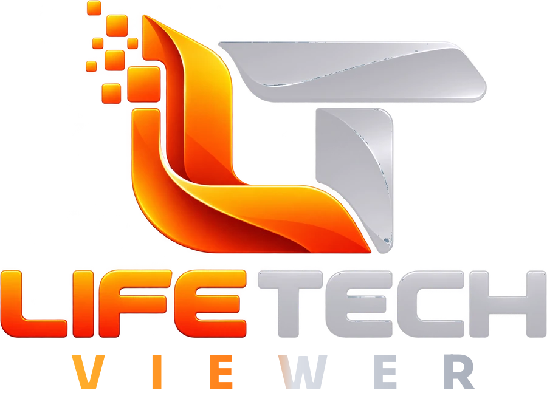

<div align="center">



# LifeTech Viewer

**A Second Life viewer made for newcomers, by LifeTech Systems.**<br>
Choose your look on day one, a clear interface, and everything you need to
find your way, on a fast modern engine (Rust, Vulkan and Metal).

[**Download**](https://viewer.lifetech.systems/#download) ·
[Changelog](CHANGELOG.md) ·
[Build it yourself](docs/BUILDING.md) ·
[Report a bug](https://github.com/LethalCyborg/LifeTech-Viewer/issues/new/choose) ·
[Website](https://viewer.lifetech.systems)

[](LICENSE)
[](docs/BUILDING.md)
[](https://www.rust-lang.org)

<sub>This software is not provided or supported by Linden Lab, the makers of Second Life.
LifeTech Systems is not affiliated with Linden Lab.</sub>

</div>

## What it is

LifeTech Viewer is based on [Aurora Viewer](https://github.com/Aurora-Viewer/Aurora-Viewer),
a modern Second Life viewer written from scratch in Rust. LifeTech keeps
everything Aurora does (its renderer, its interface, its creator tools) and
adds what makes a first week in Second Life easier:

- **Choose your look on day one**: on your very first login, pick a starter
  character and wear it at once.
- **See who's around**: People › Near you marks who is sitting and who is on
  your parcel; the mini-map shows whether an avatar is above (^) or below
  (v) you.
- **The Build Chest**: your textures and materials kept at hand for
  building.
- **Web and media built in**: profiles, search and media on prims work out
  of the box.
- **Familiar controls**: the Alt camera keys, Ctrl+W to close what you just
  opened, and the Second Life behaviour you know from the Legacy Viewer.

The full list of changes compared with Aurora Viewer, version by version,
is in the [changelog](CHANGELOG.md).

## Download

Windows (installer), macOS (Apple Silicon) and Linux:
**<https://viewer.lifetech.systems/#download>**. Each download has its
SHA-256 beside it.

- **Windows**: run the installer. It installs for your user only, without
  administrator rights. If SmartScreen asks, choose **More info** ›
  **Run anyway**.
- **macOS**: open the disk image and drag LifeTech Viewer to Applications.
  The first time, right-click it › **Open**, or System Settings › Privacy &
  Security › **Open Anyway**.
- **Linux**: unpack the archive and start `lifetech-viewer`.

## Build it yourself

```bash
git clone https://github.com/LethalCyborg/LifeTech-Viewer
cd LifeTech-Viewer
cargo build --release --locked -p lifetech-viewer
```

What each system needs, and how to make the installer, the macOS
application and the Linux archive: **[docs/BUILDING.md](docs/BUILDING.md)**.

## Staying close to Aurora Viewer

Aurora Viewer's improvements are merged as they are released, through a
renamed `aurora` branch, without undoing LifeTech's changes:
[docs/AURORA_UPDATES.md](docs/AURORA_UPDATES.md). Aurora's own guides
(features, testing, translating, the Legacy Viewer settings) are in
[docs/](docs/).

## Report a problem

[Open an issue](https://github.com/LethalCyborg/LifeTech-Viewer/issues/new/choose)
with what you did, what you expected and what happened, your system and
your graphics card. The viewer's Help › Report a bug fills most of it in.

## License

LifeTech Viewer is free software under the **GNU General Public License
version 3** ([LICENSE](LICENSE)), like Aurora Viewer it is based on; parts
ported from the Legacy Viewer were LGPL 2.1 ([NOTICE.md](NOTICE.md)).
Second Life® is a trademark of Linden Research, Inc.
